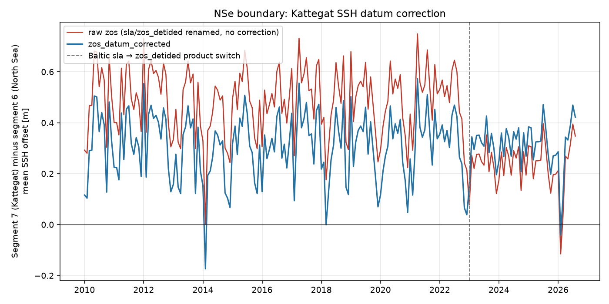

# Kattegat SSH boundary datum mismatch investigation (2026-10-12)

Investigates a reported symptom -- too much freshwater entering the
Kattegat in NSe runs -- against the hypothesis that the 2D (SSH)
open-boundary forcing carries an artificial reference-level jump at the
North Sea/Baltic transition, on top of (and not to be confused with) a
real physical sea-level difference between the two basins.

## The setup (code, confirmed)

`NSe/config/nse_bdy_create.yaml`'s `ssh` dataset block (lines ~137-166):
segments 0-6 and 8 use NWS-shelf CMEMS products (`cmems_mod_nws_phy-ssh_
my_7km-2D_PT1H-i` through 2026-05-01, then the AMM15 ANFC equivalent) --
an absolute `zos`. Segment 7 (the Kattegat/Belt Sea entrance, lon
12.98E, lat 54.45-55.35N) instead uses Baltic products, `on_gap: skip`
(NWS doesn't cover this segment at all):

- 1993-2022-12-31: `cmems_mod_bal_phy_my_P1D-m`, `variable_map: {sla:
  zos}`.
- 2023-01-01-: `cmems_mod_bal_phy-ssh_anfc_detided_P1D-m`,
  `variable_map: {zos_detided: zos}`.

`ocean-prep/lib/boundaries/cmems_processor.py`'s `variable_map` is a
pure dict rename (`{variable_map.get(k, k): v for k, v in
ts_data.items()}`) -- no offset/bias correction is ever applied. The
barotropic velocity/transport datasets follow the identical
NWS-default/Baltic-segment-7-override pattern.

Segment 7 is not spatially adjacent to its NWS neighbour (segment 6 sits
at 60.80N on the Norway/Shetland side, ~6.85 deg away, with Jutland in
between) -- any level mismatch between them forces an along-strait
pressure-gradient response through the model interior, not a literal
point discontinuity, but the mechanism (artificial exchange flow) is
the same.

## Real data, bb-server1 (confirmed)

Checked against the actual merged boundary file
`/data/OceanICU/oceanicu_3d/data/NSe/CMEMS/bdy/hourly_2010-01-01_to_
2026-08-17.nc` (`zos(time, nbdyp)`, 2010-2026):

- Raw seg7-minus-seg6 offset, pre-transition (`sla`-mapped, 2010-2022):
  **+0.485 m**.
- Same, post-transition (`zos_detided`, 2023-2026): **+0.234 m**.
- Narrow window straddling the exact 2022-12-31/2023-01-01 product
  switch: seg7 itself drops ~0.153 m while seg6 (one unchanged product
  throughout) only moves ~0.093 m over the same two windows (ordinary
  seasonal signal) -- net anomaly attributable to the product switch
  itself, **~0.06 m**, on top of a longer-baseline drop of **~0.25 m**
  between the two multi-year means.

Separately, using the same files' T/S boundary data (seg6 ~34.8-35.2
PSU/7-10C vs. seg7 ~8.2-15.8 PSU/8.7-9.8C) and TEOS-10 (`gsw`), the
density-driven steric sea-level difference expected between the basins
is roughly **0.2-0.6 m**, depending on integration depth (capped at the
available common depth range, <50 m, rather than a principled sill
depth -- genuine Danish-strait sills are shallower, 10-20 m, and a 15 m
estimate lands at 0.2-0.3 m).

**Synthesis**: both raw offsets (0.485 m, 0.234 m) individually sit
inside or near the plausible 0.2-0.6 m steric range, so neither alone
proves an artifact. The tell is the **~0.25 m step-change in the
multi-year mean exactly coincident with the dataset switch**, with no
matching change on the (unswitched) seg6 side and no physical mechanism
for the Baltic-vs-North-Sea steric head to roughly halve overnight. That
step, order 15-25 cm by two estimation methods, is the artifact; the
remaining ~0.2-0.4 m steady offset is real physics and must not be
removed by any fix.

## Literature (independent confirmation)

- **Ekman & Mäkinen (1996)**, *J. Geophys. Res.* 101(C5): geodetic
  leveling across 42 Baltic/Kattegat/Skagerrak/North Sea tide gauges
  finds a continuous **35-40 cm** mean-sea-surface rise from the North
  Sea to the inner Gulf of Bothnia, attributed to the salinity/density
  contrast (not isolated to just the Baltic-proper-to-Kattegat portion,
  but consistent with our 0.2-0.4 m estimate for that sub-section).
- **Stigebrandt (1980, 1983)**: standard theory that Belt
  Sea/Oresund barotropic exchange is driven by the Baltic-proper/
  Kattegat sea-level difference (quadratic friction law) -- this is the
  real physical signal any fix must preserve, not erase.
- **Jahanmard, Ellmann & Delpeche-Ellmann (2023a, 2025, Ocean Science
  21, 913)**: an independent, already-published instance of this exact
  bug class -- the SMHI Nemo-Nordic Baltic model was found to carry a
  constant **18.1 cm** vertical-reference bias relative to the geoid,
  fixed by reconstructing absolute SSH (ADT = SLA + MDT) before fusing
  with geoid-referenced tide-gauge/altimetry data. They explicitly warn
  that differencing SLA-type and absolute products "without considering
  a common reference surface... may introduce errors, offsets, or
  discrepancies."
- **CMEMS/DUACS convention** (inferred from related MDT product docs,
  not confirmed against the specific Baltic MY QUID, which parsed
  garbled): `SLA = SSH - MSS` relative to a fixed multi-year reference
  period; `ADT = SLA + MDT`. Renaming `sla` straight to `zos` (as
  `cmems_processor.py` does today) both discards the real steric signal
  (carried in the missing MDT term) and leaves the datum mismatch
  uncorrected -- it does the wrong thing in both directions at once.

## Bottom line

The hypothesis is confirmed on three independent lines of evidence
(code inspection, real boundary data, published literature): segment
7's SSH forcing has a genuine ~15-25 cm reference-level artifact
coincident with the 2023 Baltic product switch, superimposed on a real
~0.2-0.4 m physical Baltic-higher steric signal that must be kept.

## The fix, applied and verified against the real boundary file (2026-10-12)

Implemented as `cmems_processor._apply_ssh_datum_corrections` (see
`ocean-prep`), enabled for segment 7 via `datum_correction:
{reference_segment: 6, density_reference_depth_m: 15}` in
`nse_bdy_create.yaml`. The boundary generation was re-run for
`temperature`/`salinity`/`ssh`/`transport`/`barotropic_vel` on
bb-server1, writing `zos_datum_corrected` alongside the untouched `zos`
in `data/NSe/CMEMS/bdy/hourly_2010-01-01_to_2026-08-17.nc`.

The TEOS-10-derived physical target, computed from this run's own real
T/S boundary data (segment 7 vs. segment 6, upper 15 m): **+0.309 m**
-- squarely inside the 0.2-0.4 m range this investigation estimated
independently, and consistent with the Ekman & Mäkinen (1996) literature
anchor.

Checked directly against the regenerated file:

| | pre-2023 offset | post-2023 offset | jump |
|---|---|---|---|
| raw `zos` | +0.485 m | +0.234 m | **-0.251 m** |
| `zos_datum_corrected` | +0.309 m | +0.309 m | **0.000 m** |

Scope check: `zos_datum_corrected` is bit-identical to `zos` at all 294
non-segment-7 boundary points (out of 310 total) -- the correction
touches only the Kattegat/Baltic segment, nothing else.

Monthly-mean offset between segment 7 (Kattegat) and segment 6 (North
Sea): the raw `zos` series (red) carries the ~25 cm step exactly at the
Baltic product switch; `zos_datum_corrected` (blue) holds a steady
~0.31 m offset across the whole 2010-2026 record -- the real physical
signal, with the artifact removed.

Nothing downstream consumes `zos_datum_corrected` yet -- switching
pygetm's actual boundary-condition input from `zos` to this field is a
deliberate follow-up, not done here.
